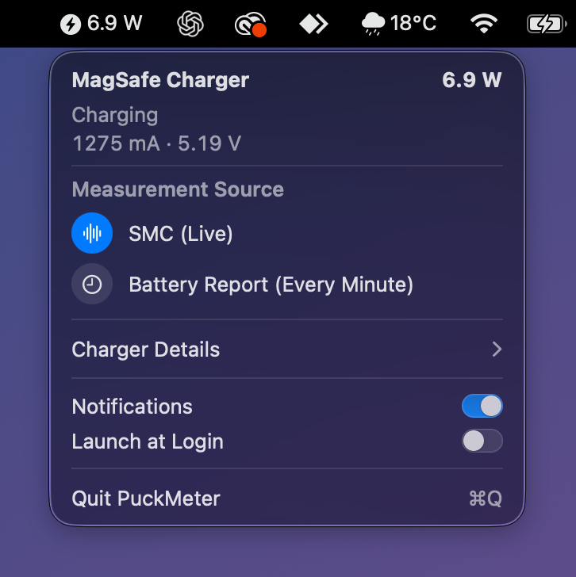

# PuckMeter

**English** | [Türkçe](README.tr.md)

A small macOS menu bar app for the Apple MagSafe Charger. It shows whether an iPhone is on the charger and how much power the charger is drawing from your Mac, live.



## Features

- Live power in the menu bar (W, mA, V), updated about once a second
- Charging state: iPhone on the charger or not
- Charger details: USB-C port, serial number, firmware version, allocated power, USB speed
- A notification when your Mac is on battery and is charging the iPhone
- Recent events list, launch at login, English and Turkish UI

## Requirements

- A Mac with Apple silicon and macOS 14 or later
- Xcode or the Command Line Tools (`xcode-select --install`)
- The MagSafe Charger plugged directly into one of the Mac's USB-C ports

Tested on a MacBook Pro (M5 Pro) with macOS 26.6.

## Install

```sh
git clone https://github.com/bucagdas/PuckMeter.git
cd PuckMeter
./build.sh
open build/PuckMeter.app
```

You can move `build/PuckMeter.app` to `/Applications`. The app is not signed by Apple, it is built and signed locally on your Mac.

On first launch macOS asks for permission to show notifications. If you missed it, turn them on in System Settings > Notifications > PuckMeter.

## Usage

Click the bolt icon in the menu bar.

- **Measurement Source**: *SMC (Live)* reads the port sensor about once a second. *Battery Report (Every Minute)* uses the value macOS updates about once a minute.
- **Charger Details**: click to show the port and charger information.
- **Notifications** and **Launch at Login** can be turned on or off in the panel.

From the terminal:

```sh
build/PuckMeter.app/Contents/MacOS/PuckMeter --status             # print the current state
build/PuckMeter.app/Contents/MacOS/PuckMeter --test-notification  # send a test notification
```

## How it works

PuckMeter only reads, it never writes to any device.

- The charger is found as USB device `05ac:0500` through IOKit.
- Live power comes from the SMC keys `D<port>JI` (current) and `D<port>JV` (voltage) of the USB-C port.
- The fallback value comes from `PowerOutDetails` of `AppleSmartBattery`.

No network access, no data collection.

## Limitations

- Power is only measured when the charger is plugged directly into the Mac, not through a hub or display.
- The app cannot tell when the iPhone is full. A full iPhone keeps drawing about 2 W from a Mac port, the same as a slowly charging one.
- The iPhone's battery percentage is not available to the Mac through the charger.

## License

[MIT](LICENSE)

PuckMeter is not affiliated with Apple. MagSafe and iPhone are trademarks of Apple Inc.
