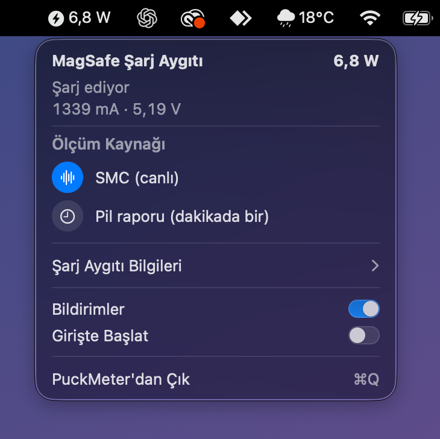

# PuckMeter

[English](README.md) | **Türkçe**

Apple MagSafe Şarj Aygıtı için küçük bir macOS menü çubuğu uygulaması. iPhone'un şarj aygıtında olup olmadığını ve şarj aygıtının Mac'inden ne kadar güç çektiğini canlı olarak gösterir.



## Özellikler

- Menü çubuğunda canlı güç (W, mA, V), yaklaşık saniyede bir güncellenir
- Şarj durumu: iPhone şarj aygıtında mı, değil mi
- Şarj aygıtı bilgileri: USB-C portu, seri numarası, yazılım sürümü, ayrılan güç, USB hızı
- Mac pildeyken iPhone'u şarj ediyorsa bildirim
- Son olaylar listesi, girişte başlatma, İngilizce ve Türkçe arayüz

## Gereksinimler

- Apple silicon işlemcili, macOS 14 veya üstü bir Mac
- Xcode ya da Komut Satırı Araçları (`xcode-select --install`)
- MagSafe Şarj Aygıtı'nın doğrudan Mac'in USB-C portlarından birine takılı olması

MacBook Pro (M5 Pro) ve macOS 26.6 üzerinde test edildi.

## Kurulum

```sh
git clone https://github.com/bucagdas/PuckMeter.git
cd PuckMeter
./build.sh
open build/PuckMeter.app
```

`build/PuckMeter.app` dosyasını `/Applications` klasörüne taşıyabilirsin. Uygulama Apple tarafından imzalanmaz, kendi Mac'inde derlenir ve yerel olarak imzalanır.

İlk açılışta macOS bildirim izni ister. Kaçırdıysan Sistem Ayarları > Bildirimler > PuckMeter yolundan açabilirsin.

## Kullanım

Menü çubuğundaki şimşek simgesine tıkla.

- **Ölçüm Kaynağı**: *SMC (canlı)* port sensörünü yaklaşık saniyede bir okur. *Pil raporu (dakikada bir)* macOS'un yaklaşık dakikada bir güncellediği değeri kullanır.
- **Şarj Aygıtı Bilgileri**: tıklayınca port ve şarj aygıtı bilgileri açılır.
- **Bildirimler** ve **Girişte Başlat** panelden açılıp kapatılabilir.

Terminalden:

```sh
build/PuckMeter.app/Contents/MacOS/PuckMeter --status             # mevcut durumu yazdırır
build/PuckMeter.app/Contents/MacOS/PuckMeter --test-notification  # test bildirimi gönderir
```

## Nasıl çalışır

PuckMeter yalnızca okur, hiçbir cihaza yazmaz.

- Şarj aygıtı IOKit üzerinden `05ac:0500` USB cihazı olarak bulunur.
- Canlı güç, USB-C portunun `D<port>JI` (akım) ve `D<port>JV` (gerilim) SMC anahtarlarından okunur.
- Yedek değer `AppleSmartBattery` içindeki `PowerOutDetails` alanından gelir.

İnternet bağlantısı kullanmaz, veri toplamaz.

## Sınırlamalar

- Güç yalnızca şarj aygıtı doğrudan Mac'e takılıyken ölçülür; hub ya da ekran üzerinden ölçülmez.
- Uygulama iPhone'un dolduğunu anlayamaz. Dolu bir iPhone, Mac portundan yavaş şarj olan bir iPhone kadar, yaklaşık 2 W çekmeye devam eder.
- iPhone'un pil yüzdesi şarj aygıtı üzerinden Mac'e iletilmez.

## Lisans

[MIT](LICENSE)

PuckMeter'ın Apple ile bir bağlantısı yoktur. MagSafe ve iPhone, Apple Inc.'in ticari markalarıdır.
